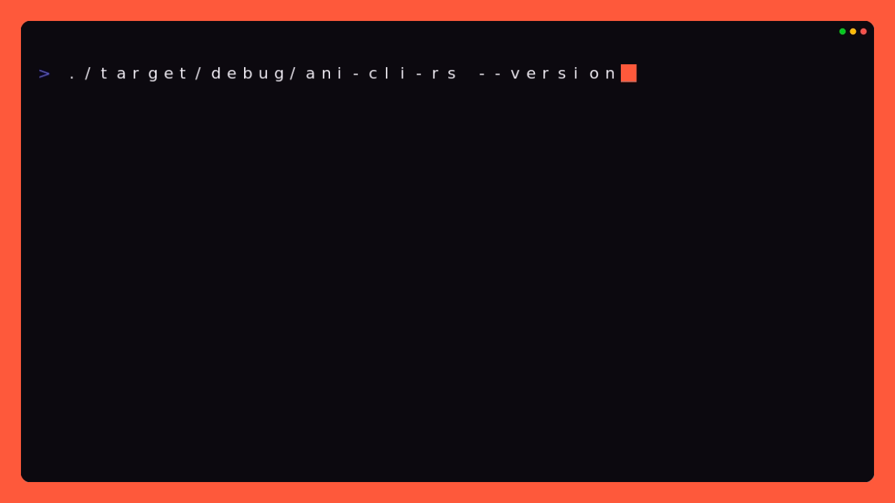

<div align="center">

# ani-cli-rs

**A fast, cross-platform anime CLI written in Rust.**

Search, stream, and download anime directly from your terminal with native playback, multiple Anikoto catalogs, and support for MegaPlay/KotoCDN sources.

[](https://vorlie.github.io/ani-cli-rs/)
[](https://github.com/vorlie/ani-cli-rs)
[](LICENSE)
[](https://discord.gg/9SXX6ddpNR)

Crates:
[](https://crates.io/crates/ani-cli-rs)
[](https://crates.io/crates/ani-cli-rs)

Github:
[](https://github.com/vorlie/ani-cli-rs/releases)
[](https://github.com/vorlie/ani-cli-rs/releases)

[**Documentation**](https://vorlie.github.io/ani-cli-rs/) ·
[**Installation**](https://vorlie.github.io/ani-cli-rs/guides/installation/) ·
[**CLI Reference**](https://vorlie.github.io/ani-cli-rs/reference/cli/) ·
[**Contributing**](CONTRIBUTING.md) ·
[**Discord**](https://discord.gg/9SXX6ddpNR)

</div>



---

## What is ani-cli-rs?

`ani-cli-rs` is an independent Rust implementation inspired by [ani-cli](https://github.com/pystardust/ani-cli).

It provides the familiar interactive terminal experience across **Windows, Linux, macOS, and Termux**, while using a native Rust implementation for searching, provider resolution, playback, downloads, and local HLS handling.

Unlike the original Bash project, the executable is intentionally named `ani-cli-rs` and the underlying functionality is also available as the `ani_lib` Rust library.

### Highlights

* 🦀 Native Rust implementation
* 🖥️ Windows, Linux, macOS, and Termux support
* 🔎 Interactive anime and episode search
* 🌐 Two independent Anikoto catalogs
* 🎬 Native MegaPlay source extraction
* 📡 Local KotoCDN HLS relay
* 💬 External provider subtitle support
* ⬇️ Parallel and fallback download support
* 📺 mpv, IINA, VLC, Android mpv, and Syncplay
* 🤖 Scriptable commands with JSON output
* 📚 Reusable Rust library API

---

## Community

ani-cli-rs is built in the open and improved through code, bug reports, documentation, testing, and provider work.

<div align="center">

**⭐ Star the project if you find it useful**

[](https://github.com/vorlie/ani-cli-rs)
[](https://github.com/vorlie/ani-cli-rs)
[](https://github.com/vorlie/ani-cli-rs/graphs/contributors)

</div>

### Contributors

Thank you to everyone who has contributed code, fixes, ideas, documentation, testing, and feedback.

---

## Quick start

### Search and watch

```console
ani-cli-rs "frieren"
```

### Common commands

```console
ani-cli-rs --dub -q 720p "cowboy bebop"

ani-cli-rs -e 2-4 "one piece"

ani-cli-rs --continue

ani-cli-rs --download "anime title"

ani-cli-rs --allow-adult "search query"

ani-cli-rs --provider anikoto2 "black torch"
```

### Termux

```sh
ani-cli-rs "cyberpunk"

ani-cli-rs --vlc "cyberpunk"
```

See the **[CLI reference](https://vorlie.github.io/ani-cli-rs/reference/cli/)** for all commands, options, environment variables, JSON workflows, and keyboard controls.

---

## Features

### Playback

* Interactive anime, season, and episode selection
* Subbed and dubbed results
* Quality selection
* Episode ranges and multi-selection
* Playback history and continuation
* Next, previous, replay, and episode-selection controls
* mpv, IINA, VLC, Android mpv, and Syncplay
* Optional `--exit-after-play` and `--no-detach` modes

### Providers

* Independent Anikoto API and Anikoto.cz catalogs
* Native MegaPlay source extraction
* Transparent KotoCDN HLS handling
* Provider subtitles exposed as normal HLS subtitle tracks
* Provider-aware IDs and history entries
* Explicit provider selection without silent catalog switching

### Downloads

* Batch episode resolution before transfers begin
* aria2 parallel downloads
* yt-dlp and FFmpeg fallbacks
* HLS downloads
* Provider subtitle embedding into MP4 where supported

### Automation

Commands can return machine-readable JSON for scripting and integrations:

```console
ani-cli-rs search --json "frieren"

ani-cli-rs episodes --json SHOW_ID --mode sub

ani-cli-rs links --json SHOW_ID 1 --quality 1080p

ani-cli-rs play SHOW_ID 1 --title "Frieren" --no-detach

ani-cli-rs download SHOW_ID 1 --output ./downloads

ani-cli-rs update --check
```

`episodes`, `links`, `play`, and `download` expect the show ID returned by `search`.

---

## Installation

Official releases are currently provided for:

| Platform     | Distribution     |
| ------------ | ---------------- |
| Windows x64  | Prebuilt release |
| Linux x86-64 | Prebuilt release |
| macOS        | Source build     |
| Termux       | Source build     |
| Linux ARM64  | Source build     |

Prebuilt macOS, Android/Termux, and Linux ARM64 binaries are not currently published.

### Linux

```sh
curl -fsSL https://raw.githubusercontent.com/vorlie/ani-cli-rs/master/scripts/install.sh -o install.sh
sh install.sh
rm install.sh
```

### Windows PowerShell

Portable installation:

```powershell
Invoke-WebRequest https://raw.githubusercontent.com/vorlie/ani-cli-rs/master/scripts/install.ps1 -OutFile install.ps1
.\install.ps1
Remove-Item .\install.ps1
```

For the Inno Setup installer:

```powershell
.\install.ps1 -UseSetup
```

### Android / Termux

```sh
pkg update
pkg install git rust termux-tools

git clone https://github.com/vorlie/ani-cli-rs.git
cd ani-cli-rs

cargo build --release --locked
install -Dm755 target/release/ani-cli-rs "$PREFIX/bin/ani-cli-rs"
```

Install an Android video player such as mpv-android or VLC from an Android app source.

> **Do not use `pkg install vlc`.**
> That installs a terminal VLC build rather than the Android VLC application used by this integration.

The installation scripts verify release archives against their published SHA-256 checksums and install to `~/.local/bin` by default.

For PATH configuration, custom installation locations, uninstalling, and source builds, see the **[installation guide](https://vorlie.github.io/ani-cli-rs/guides/installation/)**.

---

## Requirements

### Desktop

* **Linux / Windows:** [mpv](https://mpv.io/) for default playback
* **macOS:** [IINA](https://iina.io/) for tested out-of-the-box playback

  * `brew install --cask iina`

Optional:

* [VLC](https://www.videolan.org/vlc/)
* [Syncplay](https://syncplay.pl/)
* [aria2](https://aria2.github.io/)
* [yt-dlp](https://github.com/yt-dlp/yt-dlp)
* [FFmpeg](https://ffmpeg.org/)

Desktop programs must be available through `PATH`.

### Termux

Tested Android playback options include:

* mpv-android
* VLC
* Amnis
* Samsung Video Player

On Termux, normal playback uses mpv-android. `--vlc` requests Android VLC when the explicit activity bridge works; otherwise ani-cli-rs falls back to Android's media handler through `termux-open`.

See **[Playback and Players](https://vorlie.github.io/ani-cli-rs/guides/playback-and-players/)** and **[Downloads](https://vorlie.github.io/ani-cli-rs/guides/downloads/)** for details.

---

## CLI compatibility

The primary interface follows Bash ani-cli conventions:

```text
ani-cli-rs [OPTIONS] [QUERY]
```

Common compatibility options include:

```text
-c, --continue           Continue from history
-d, --download           Download instead of play
-D, --delete             Delete history
-s, --syncplay           Use Syncplay
-S, --select-nth         Select the nth search result
-q, --quality            best, worst, or a resolution
-v, --vlc                Use VLC
-e, --episode            Episode or range
-r, --range              Episode range alias
-a, --allow-adult        Include adult results
-N, --nextep-countdown   Show release timing
-U, --update             Update from GitHub Releases
-p, --provider           anikoto or anikoto2

    --dub                Use dubbed results
    --multi-selection    Select multiple episodes
    --no-detach          Keep the player attached
    --exit-after-play    Skip the post-playback menu
```

Run:

```console
ani-cli-rs --help
```

for the authoritative list.

---

## Rust library

The provider and playback functionality is also available as the `ani_lib` Rust library.

This allows applications to integrate ani-cli-rs provider resolution directly instead of spawning the CLI as a subprocess.

```toml
[dependencies]
ani-cli-rs = "0.9.6"
```

Example:

```rust
use ani_lib::{
    AnikotoCzClient,
    TranslationType,
};

#[tokio::main]
async fn main() -> Result<(), Box<dyn std::error::Error>> {
    let client = AnikotoCzClient::new()?;

    let results = client
        .search("Frieren", TranslationType::Sub)
        .await?;

    for result in results {
        println!("{}", result.name);
    }

    Ok(())
}
```

The library exposes the APIs used by the CLI for:

* Provider and catalog access
* Search and stream resolution
* Playback
* Downloads
* History
* HLS relay
* Internationalization
* Shared data models

### Public API

The current public API includes:

* `AnikotoClient`
* `AnikotoClientBuilder`
* `AnikotoCzClient`
* `AnikotoCzClientBuilder`
* `SearchResult`
* `StreamLink`
* `SubtitleTrack`
* `TranslationType`
* `SearchOptions`
* `CatalogProvider`
* `HlsRelay`
* `relay_stream`
* `relay_stream_without_hls_subtitles`
* `download_stream`
* `HistoryStore`
* `HistoryEntry`
* `Player`
* `PlayerKind`
* `PlayerOptions`
* `I18n`
* `Locale`

For application integration, see the **[Rust library integration guide](https://vorlie.github.io/ani-cli-rs/development/using-as-a-library/)**.

---

## Kioku

**[Kioku](https://github.com/vorlie/kioku)** is a native desktop AniList manager built around `ani-cli-rs`.

It combines AniList library management with integrated anime search and media playback without requiring a separate player application.

> [!NOTE]
> Kioku is currently in early development and is **not feature-complete**. Expect incomplete features, UI changes, and breaking changes.

---

## Provider architecture

ani-cli-rs currently supports two independent catalogs:

```text
Anikoto API
    └── anikoto:<id>

Anikoto.cz
    └── anikoto2:<slug>
```

The prefixes are preserved through search, episode resolution, playback, and history so the correct catalog can be selected automatically.

The catalogs are intentionally **not merged**, and playback never silently switches between them.

To change the default interactive provider:

```sh
ANI_CLI_RS_PROVIDER=anikoto2 ani-cli-rs "black torch"
```

Provider internals are documented in:

* [`docs/ANIKOTO-KOTOCDN.md`](docs/ANIKOTO-KOTOCDN.md)
* [`docs/ANIKOTO-CZ.md`](docs/ANIKOTO-CZ.md)

---

## Security and diagnostics

Official Windows binaries are currently unsigned and may trigger SmartScreen or heuristic antivirus warnings.

ani-cli-rs performs network requests, launches media players and downloaders, and temporarily creates a loopback HLS relay for KotoCDN playback. These behaviors may produce misleading automated classifications.

Release installers verify published checksums.

For diagnostic logging:

```powershell
$env:RUST_LOG = "ani_cli_rs=debug,ani_cli=debug"
ani-cli-rs "cyberpunk edgerunners"
```

```bash
RUST_LOG=ani_cli_rs=debug,ani_cli=debug ani-cli-rs "cyberpunk edgerunners"
```

Use `trace` instead of `debug` for full stream-resolution and relay tracing.

See **[Security and Privacy](https://vorlie.github.io/ani-cli-rs/development/security/)** for manual verification and privacy details.

---

## Development

ani-cli-rs uses Rust 2024 and requires a current stable Rust toolchain.

```console
cargo build --release

cargo fmt --check

cargo check --all-targets

cargo clippy --all-targets -- -D warnings

cargo test
```

The repository also contains a deterministic showcase generator that produces the terminal recording, screenshots, and README GIF without contacting anime providers:

```powershell
.\showcase\showcase.ps1
```

See **[Building and Releasing](https://vorlie.github.io/ani-cli-rs/development/building/)** and the **[showcase guide](showcase/README.md)** for more information.

---

## Documentation

The complete documentation is available at:

**https://vorlie.github.io/ani-cli-rs/**

It covers:

* Installation
* Configuration
* Playback and players
* Downloads
* CLI commands
* JSON automation
* Provider internals
* HLS relay behavior
* Library integration
* Development
* Security and privacy
* Troubleshooting

Documentation lives alongside the source code in [`website/docs/`](website/docs/index.md), so documentation changes can be reviewed together with code changes.

---

## Troubleshooting

When something goes wrong, first identify which stage failed:

```text
Installation / PATH
        ↓
Search / episode discovery
        ↓
Provider resolution
        ↓
Source resolution
        ↓
KotoCDN / HLS relay
        ↓
Player launch
        ↓
Download transfer
        ↓
Finalization
```

This distinction matters: reinstalling ani-cli-rs will not fix a provider outage, and changing players will not fix an episode that failed during source resolution.

### Error codes

ani-cli-rs uses stable error codes to make failures easier to understand and report. Error codes follow the format `ACL-xxxx`:

- **ACL-1xxx**: Network / provider errors
- **ACL-2xxx**: Search / anime / episode errors  
- **ACL-3xxx**: Streaming / source errors
- **ACL-4xxx**: Download errors
- **ACL-5xxx**: Playback errors
- **ACL-6xxx**: Filesystem / configuration errors
- **ACL-7xxx**: Authentication / external services
- **ACL-9xxx**: Internal / unexpected errors

When reporting issues, always include the error code (e.g., `ACL-3001`) along with the complete error message.

Example error output:
```
error[ACL-3001]: No playable sources found

No playable sources were found for episode 7.

help: Try another provider or try again later.
docs: https://vorlie.github.io/ani-cli-rs/errors#ACL-3001
```

For a complete error code reference with causes and solutions, see the **[Error codes documentation](https://vorlie.github.io/ani-cli-rs/errors/)**.

See the **[Troubleshooting guide](https://vorlie.github.io/ani-cli-rs/support/troubleshooting/)** for diagnostic steps and logging information.

---

## Scope

ani-cli-rs currently targets:

* Windows
* Linux
* macOS source builds
* Termux source builds

The following are intentionally outside the current scope:

* iSH adapters
* rofi/dmenu integration
* Intro skipping
* System-journal logging

---

## Media hosting and legal notice

`ani-cli-rs` does **not** host, mirror, or distribute media.

The application retrieves search and stream information from third-party providers and passes resolved streams to the user's selected playback or download tool.

For HLS sources requiring local processing, ani-cli-rs can create a temporary loopback relay on the user's device. This relay is local and is not an internet-facing media proxy.

Users are responsible for complying with applicable laws and the terms of service of the services they access.

See [`DMCA.md`](DMCA.md) for the project's copyright and takedown policy.

---

## Contributing

Contributions are welcome.

You can help by:

* Reporting bugs
* Improving documentation
* Adding tests
* Improving provider handling
* Fixing playback or download issues
* Improving cross-platform support
* Contributing to the Rust library
* Reviewing pull requests

See [`CONTRIBUTING.md`](CONTRIBUTING.md) to get started.

Security issues should be reported according to [`SECURITY.md`](SECURITY.md).

---

## License

Licensed under [GPL-3.0-only](LICENSE).
# Contributing to ani-cli-rs

Thank you for helping improve ani-cli-rs. Bug fixes, compatibility improvements, tests, documentation, and focused feature proposals are welcome.

## Before starting

- Search existing issues and pull requests.
- Keep changes scoped to one problem where practical.
- Open an issue before implementing a large CLI redesign, public API break, new network provider, or plugin architecture change.
- Do not commit credentials, cookies, complete signed media URLs, personal filesystem paths, or raw debug dumps containing private information.

> **Using AI?** See [AI_POLICY.md](AI_POLICY.md) for the project's expectations around AI-assisted contributions.

## Development setup

Install the current stable Rust toolchain. The package uses Rust edition 2024.

```console
git clone https://github.com/vorlie/ani-cli-rs.git
cd ani-cli-rs
cargo build
```

Playback and HLS download tests may additionally require mpv, VLC, Syncplay, yt-dlp, or FFmpeg, depending on the workflow being changed.

## Required checks

Run these before submitting a pull request:

```console
cargo fmt --check
cargo check --all-targets
cargo clippy --all-targets -- -D warnings
cargo test
```

Normal tests must remain deterministic and must not require live provider access. Use fixtures or the mock HTTP server for scraper changes. Anikoto API/MegaPlay smoke tests require `ANI_CLI_LIVE_ANIKOTO=1`; Anikoto.cz smoke tests require `ANI_CLI_LIVE_ANIKOTO2=1`.

## Scraper changes

Read [`docs/ANIKOTO-KOTOCDN.md`](docs/ANIKOTO-KOTOCDN.md) before changing the Anikoto API/MegaPlay workflow, or [`docs/ANIKOTO-CZ.md`](docs/ANIKOTO-CZ.md) before changing the Anikoto.cz AJAX and server workflow.

- Include sanitized fixtures for new response shapes and encryption paths.
- Test partial provider failures instead of assuming every extracted source works.
- Preserve required request headers in `StreamLink` rather than constructing shell command strings.
- Avoid logging complete temporary media URLs, authorization values, cookies, or other replayable credentials.
- Explain whether behavior matches Bash ani-cli, AniPlay, or a newly observed upstream change.

## CLI and platform changes

- Preserve `ani-cli [options] [query] [options]` compatibility where possible.
- Keep process arguments separate and platform-safe.
- Add parser or integration tests for new flags and environment variables.
- Document intentional Windows, Linux, or macOS differences.

## Error handling and reporting

ani-cli-rs uses stable error codes (e.g., `ACL-3001`) to make failures easier to understand and report. When contributing error-related changes:

- Use structured error variants with context fields
- Include error code stability tests for new error types
- Update the error documentation in `website/docs/errors/index.md`
- Include the error code in issue titles and descriptions
- Run `cargo test` to verify error code stability tests pass

For the complete error code reference, see the [Error codes documentation](https://vorlie.github.io/ani-cli-rs/errors/).

## Commits and pull requests

Use concise, imperative commit messages. Conventional prefixes such as `fix:`, `feat:`, `docs:`, `test:`, and `chore:` are encouraged but not mandatory.

Fill out the pull-request template, link the relevant issue, and describe manual testing. Contributions are accepted under the repository's GPL-3.0-only license.
# Security policy

## Supported versions

Security fixes target the latest published release and the current `master` branch. Older releases may not receive backports; users should reproduce a suspected issue on the latest version when safe to do so.

## Reporting a vulnerability

Do not open a public issue for vulnerabilities that could expose credentials, execute unintended commands, escape filesystem boundaries, replace release artifacts, or otherwise harm users.

Use GitHub's **Report a vulnerability** option on the repository Security tab to create a private security advisory:

https://github.com/vorlie/ani-cli-rs/security/advisories/new

Include:

- The affected version, operating system, and architecture.
- Reproduction steps or a minimal proof of concept.
- The expected security boundary and practical impact.
- Any suggested mitigation, if known.

Remove real credentials, cookies, authorization headers, and active media URLs. Use synthetic values wherever possible. Please allow reasonable time to investigate and prepare a release before publishing details.

Provider outages, expired links, antivirus heuristics without an exploitable security impact, and ordinary playback failures should use the public issue templates instead.

# DMCA & Copyright Disclaimer

`ani-cli-rs` is an open-source Rust command-line application and library for searching, resolving, and playing media streams provided by third-party services.

## Media and Third-Party Sources

`ani-cli-rs` does **not** host, upload, maintain, or operate a library of the media that it resolves.

The application may query third-party websites and APIs at runtime and may receive media or stream metadata from those services. Resolved streams are passed to the user's local playback or download software.

For HLS sources that require local processing, `ani-cli-rs` may create a temporary loopback relay on the user's device. This relay exists solely to facilitate playback and is not an internet-facing media host or proxy.

`ani-cli-rs` does not control the availability, ownership, licensing, or copyright status of content served by third-party services.

## Copyright Complaints

If you are a copyright owner or an authorized representative and believe that material accessed through a third-party service infringes your rights, please direct the relevant complaint to the service or hosting provider responsible for that material.

Because `ani-cli-rs` does not host or control those third-party services or their media, the project cannot remove media from those services.

## Source Code and Repository Notices

If you believe that material contained directly in the `ani-cli-rs` source repository infringes your copyright or other intellectual property rights, please contact the project maintainer with sufficient information to identify the material and the rights allegedly affected.

For source-code-related copyright concerns, you may contact:

**Project:** `ani-cli-rs`
**Repository:** https://github.com/vorlie/ani-cli-rs

Please provide:

* identification of the copyrighted work or other protected material;
* identification and location of the material in this repository;
* your contact information;
* a statement that you have a good-faith belief that the material is being used without authorization;
* a statement that the information provided is accurate and, where applicable, that you are authorized to act on behalf of the rights holder.

Formal notices will be reviewed and handled in accordance with applicable law and the policies of the platform hosting the relevant material.

## Disclaimer

This document describes the technical operation and scope of `ani-cli-rs` and is not legal advice.

Users are responsible for their use of the software and for complying with applicable laws, regulations, licenses, and the terms of services they access.
# ani-cli-rs external plugin roadmap

Status: proposed

This document describes a phased plan for adding external executable plugins to `ani-cli-rs`. The initial goal is provider extensibility: adding search, episode-list, and stream-resolution backends without rebuilding the main application.

External processes are preferred over in-process Rust dynamic libraries. They avoid Rust ABI instability, isolate crashes, permit plugins written in any language, and provide a protocol that AniPlay could adopt later.

## Goals

- Allow third-party catalog and streaming providers to integrate with the existing CLI workflow.
- Keep the main executable stable when a plugin crashes, hangs, or returns malformed data.
- Define a small, versioned, language-independent protocol.
- Preserve non-interactive JSON use and the familiar interactive workflow.
- Support Windows, Linux, and macOS source builds without requiring identical compiler toolchains.
- Make plugin discovery, diagnostics, updates, and removal understandable to terminal users.
- Leave room for metadata, subtitle, resolver, and integration plugins after provider support is stable.
- Make the provider protocol reusable by AniPlay where practical.

## Non-goals for the first release

- Loading arbitrary Rust traits from `.dll`, `.so`, or `.dylib` files.
- Installing plugins automatically from untrusted URLs.
- A centralized plugin marketplace.
- Executing plugin-provided UI code inside the terminal application.
- Perfect operating-system sandboxing on every platform.
- Allowing plugins to mutate ani-cli-rs history or configuration directly.
- Replacing both built-in Anikoto implementations with plugins immediately.

## Proposed layout

Each plugin lives in its own directory:

```text
plugins/
└── example-provider/
    ├── plugin.json
    ├── example-provider.exe
    ├── LICENSE
    └── README.md
```

Platform-native user plugin directories should be used by default:

- Windows: `%LOCALAPPDATA%\ani-cli-rs\plugins`
- Linux: `$XDG_DATA_HOME/ani-cli-rs/plugins`, falling back to `~/.local/share/ani-cli-rs/plugins`
- macOS: `~/Library/Application Support/ani-cli-rs/plugins`

An additional directory may be supplied through `ANI_CLI_PLUGIN_DIR`. The explicit directory takes priority over the platform directory, making portable and development setups easy to test.

## Manifest version 1

`plugin.json` is read before starting the executable:

```json
{
  "manifestVersion": 1,
  "id": "example-provider",
  "name": "Example Provider",
  "version": "1.0.0",
  "protocolVersion": 1,
  "type": "provider",
  "description": "Example anime catalog and streaming provider.",
  "homepage": "https://example.invalid/plugin",
  "license": "GPL-3.0-only",
  "executables": {
    "windows-x86_64": "example-provider.exe",
    "windows-aarch64": "example-provider-arm64.exe",
    "linux-x86_64": "example-provider",
    "linux-aarch64": "example-provider-arm64",
    "macos-x86_64": "example-provider-macos",
    "macos-aarch64": "example-provider-macos-arm64"
  },
  "capabilities": ["search", "episodes", "streams"],
  "permissions": {
    "networkDomains": ["api.example.invalid", "video.example.invalid"]
  }
}
```

Manifest validation must reject:

- Unknown manifest or incompatible protocol versions.
- Invalid or duplicate plugin IDs.
- Absolute executable paths or paths escaping the plugin directory.
- Missing executables for the current platform and architecture.
- Unsupported plugin types or capabilities.
- Invalid URLs and malformed network-domain declarations.
- Manifests larger than a conservative size limit.

The manifest describes intent; it is not an operating-system sandbox. A normal executable can still access anything permitted to the current user unless stronger isolation is added later.

## Protocol version 1

Plugins communicate through newline-delimited JSON on stdin and stdout.

- One complete JSON object per line.
- UTF-8 encoding only.
- `stdout` is reserved exclusively for protocol messages.
- Human-readable diagnostics go to `stderr`.
- Every request contains an ID copied into its response.
- Unknown fields are ignored when safe, allowing additive protocol evolution.
- The host limits line length and total buffered output.

### Startup handshake

The host starts the plugin and sends:

```json
{"protocol":1,"id":1,"method":"initialize","params":{"host":{"name":"ani-cli-rs","version":"0.2.0"},"locale":"en-US"}}
```

The plugin responds:

```json
{"protocol":1,"id":1,"result":{"plugin":{"id":"example-provider","version":"1.0.0"},"capabilities":["search","episodes","streams"]}}
```

The returned ID and version must match the manifest. A mismatch disables the plugin for that process and produces a clear diagnostic.

### Search

```json
{"protocol":1,"id":2,"method":"search","params":{"query":"frieren","mode":"sub","allowAdult":false}}
```

```json
{"protocol":1,"id":2,"result":[{"id":"show-123","name":"Frieren: Beyond Journey's End","episodes":28}]}
```

### Episode list

```json
{"protocol":1,"id":3,"method":"episodes","params":{"animeId":"show-123","mode":"sub"}}
```

```json
{"protocol":1,"id":3,"result":["1","2","3","4"]}
```

Episode identifiers remain strings to support specials, decimals, and provider-specific numbering.

### Stream resolution

```json
{"protocol":1,"id":4,"method":"streams","params":{"animeId":"show-123","episode":"1","mode":"sub"}}
```

```json
{"protocol":1,"id":4,"result":[{"url":"https://video.example.invalid/master.m3u8","resolution":"1080p","hls":true,"provider":"Example","downloadable":true,"headers":{"referer":"https://example.invalid/","origin":"https://example.invalid"}}]}
```

Stream results should map directly to the existing `StreamLink` model so built-in and external providers share quality selection, playback, download, and history behavior.

### Errors

Plugins return structured errors:

```json
{"protocol":1,"id":4,"error":{"code":"rate_limited","message":"Try again later.","retryAfterSeconds":5}}
```

Initial error codes:

- `invalid_request`
- `not_found`
- `unavailable`
- `rate_limited`
- `network`
- `provider_changed`
- `permission_required`
- `internal`

Unknown codes are treated as `internal` while preserving the plugin's safe human-readable message.

### Shutdown

The host sends a best-effort shutdown request before closing stdin:

```json
{"protocol":1,"id":5,"method":"shutdown","params":{}}
```

The host may terminate the process after a short grace period. Plugins must not assume that shutdown is always delivered after crashes or forced termination.

## Process lifecycle

The first implementation should start one process for the selected plugin and reuse it for the current CLI session.

Required controls:

- Startup timeout, initially 5 seconds.
- Search and episode-list timeout, initially 15 seconds.
- Stream-resolution timeout, initially 30 seconds.
- Maximum JSON line size, initially 1 MiB.
- Maximum stderr retained for an error report, initially 64 KiB.
- Process termination when stdout is malformed, the handshake fails, or a timeout expires.
- Concurrent draining of stderr so a verbose plugin cannot deadlock on a full pipe.
- Cleanup through a process guard when the CLI exits early.
- No shell command construction; executable paths and arguments are passed directly to the process API.

Protocol timeouts should be configurable for diagnostics, but plugins must not be allowed to disable them unilaterally.

## CLI integration

Proposed commands and options:

```console
ani-cli-rs plugins list
ani-cli-rs plugins inspect example-provider
ani-cli-rs plugins doctor example-provider
ani-cli-rs plugins enable example-provider
ani-cli-rs plugins disable example-provider
ani-cli-rs --provider example-provider "frieren"
ani-cli-rs search --provider example-provider --json "frieren"
```

Proposed environment variables:

- `ANI_CLI_PROVIDER`: default provider ID.
- `ANI_CLI_PLUGIN_DIR`: additional or portable plugin directory.
- `ANI_CLI_PLUGIN_TIMEOUT`: diagnostic timeout override with a documented upper bound.

Built-in providers use stable IDs (`anikoto` and `anikoto2`). Provider-prefixed show IDs keep history entries self-routing without changing the legacy tab-separated file layout.

Interactive provider selection should appear only when more than one enabled provider is available. Existing users with no plugins installed should see no additional prompt.

## Security model

Executable plugins are trusted native code running as the current user. The initial release must communicate this clearly during manual installation and first enablement.

Minimum protections:

- Never discover loose executables without a valid manifest.
- Never execute a path outside the resolved plugin directory.
- Do not search the current working directory implicitly.
- Reject symlink or junction escapes after resolving the executable path.
- Pass no secrets or full environment dump to plugins.
- Start with a minimal documented environment where practical.
- Validate every response before converting it into public library models.
- Redact temporary media query strings and authorization headers from routine logs.
- Display the plugin ID in every plugin-originated error.
- Keep plugin auto-download and auto-update out of version 1.
- Document that domain permissions are advisory until requests are proxied through the host or an OS sandbox is implemented.

Future hardening may include:

- Optional SHA-256 hashes in manifests.
- Signed release metadata and publisher identity.
- Windows job objects, Linux namespaces/seccomp, and macOS sandbox profiles where maintainable.
- A host-proxied HTTP capability that can enforce domain declarations.
- WebAssembly plugins for portable parsers and resolvers requiring stronger isolation.

## Library architecture

Introduce an internal asynchronous provider abstraction implemented by built-in providers and external plugins:

```rust
trait Provider {
    async fn search(
        &self,
        query: &str,
        mode: TranslationType,
        options: SearchOptions,
    ) -> Result<Vec<SearchResult>>;

    async fn episodes(
        &self,
        anime_id: &str,
        mode: TranslationType,
    ) -> Result<Vec<String>>;

    async fn streams(
        &self,
        anime_id: &str,
        episode: &str,
        mode: TranslationType,
    ) -> Result<Vec<StreamLink>>;
}
```

The exact public API should be decided separately. The initial trait may remain internal until provider identity, error stability, and async-trait ergonomics are settled.

Suggested modules:

```text
src/plugins/
├── mod.rs
├── discovery.rs
├── manifest.rs
├── protocol.rs
├── process.rs
└── provider.rs
```

## Delivery phases

### Phase 0: protocol specification

- Finalize manifest and protocol version 1 schemas.
- Decide provider IDs and history migration behavior.
- Add JSON Schema documents or equivalent fixture validation.
- Publish a minimal reference plugin contract.
- Define which fields are stable and which are implementation details.

Exit criteria: a plugin author can implement the protocol without reading ani-cli-rs source code.

### Phase 1: discovery and diagnostics

- Resolve platform plugin directories.
- Parse and validate manifests without executing plugins.
- Add `plugins list`, `plugins inspect`, and `plugins doctor`.
- Report duplicate IDs, incompatible versions, missing binaries, and unsafe paths.
- Add enable/disable configuration.

Exit criteria: malformed installations are diagnosed precisely and no plugin code is executed during normal discovery.

### Phase 2: process protocol

- Implement the JSON-lines codec and request IDs.
- Add handshake, timeout, size-limit, stderr-draining, and shutdown behavior.
- Map structured plugin errors into ani-cli-rs error categories.
- Create a fake executable plugin used by integration tests.
- Verify paths and arguments on Windows and Unix platforms.

Exit criteria: the host can safely exercise a deterministic echo/reference plugin under success, timeout, crash, and malformed-output scenarios.

### Phase 3: provider integration

- Introduce the shared provider abstraction.
- Wrap both existing Anikoto clients as built-in providers.
- Implement external search, episodes, and streams methods.
- Add `--provider` and `ANI_CLI_PROVIDER`.
- Reuse existing quality selection, playback, downloads, and headers for plugin streams.
- Extend history with provider identity while preserving old tab-separated entries.

Exit criteria: a reference external provider completes interactive playback, scripted JSON output, downloading, and history continuation.

### Phase 4: author tooling

- Publish a small Rust protocol SDK with no dependency on internal scraper code.
- Publish language-neutral schemas and example request transcripts.
- Add a plugin conformance test command.
- Provide a template provider repository and release packaging examples.
- Document stdout/stderr rules and common deadlock mistakes.

Exit criteria: a third party can build and package a provider without copying private host implementation details.

### Phase 5: shared AniPlay compatibility

- Review protocol fields against AniPlay's provider and `StreamLink` models.
- Add host capability negotiation rather than assuming identical features.
- Define optional fields for subtitles, embed-only streams, and browser fallback.
- Build one reference plugin used unchanged by both hosts.
- Keep host-specific playback and download behavior outside the plugin.

Exit criteria: one packaged provider can serve both ani-cli-rs and AniPlay through the same protocol version.

### Phase 6: distribution and trust

- Define an optional signed plugin-index format.
- Add checksum verification for manually requested installations.
- Establish publisher and revocation metadata.
- Design updates as explicit user actions with downgrade support.
- Evaluate whether a curated registry is worth its moderation and security cost.

Exit criteria: distribution can be introduced without silently executing newly downloaded code.

## Test plan

Unit tests:

- Manifest parsing, platform selection, path traversal, and duplicate IDs.
- Request and response serialization.
- Protocol version and capability negotiation.
- Response validation for search results, episodes, streams, and headers.
- Structured error mapping and safe message truncation.
- History compatibility with and without provider identity.

Integration tests with fake plugin executables:

- Successful handshake and all provider methods.
- Startup failure, non-zero exit, crash, and early EOF.
- Startup and request timeouts.
- Invalid UTF-8, malformed JSON, oversized lines, and mismatched IDs.
- Protocol output mistakenly written to stderr and logs mistakenly written to stdout.
- Large stderr output without deadlock.
- Graceful and forced shutdown.
- Executable paths containing spaces and Unicode.
- Windows `.exe` and Unix executable-bit behavior.
- Multiple plugins with conflicting IDs.
- Non-interactive JSON output containing no plugin log noise.

Manual smoke tests:

- Windows 11 PowerShell and Command Prompt.
- Ubuntu/Debian and a non-Debian Linux distribution.
- x86-64 and ARM64 where release hardware or emulation is available.
- Interactive playback, direct download, HLS download, and history continuation.

## Compatibility policy

- `manifestVersion` changes only when manifest interpretation becomes incompatible.
- `protocolVersion` changes only for incompatible wire changes.
- Additive optional fields do not require a protocol bump.
- Hosts advertise their version and supported capabilities during initialization.
- Plugins must fail clearly when a required capability is unavailable.
- At least one previous protocol version should be considered for support after version 2 exists, but no promise is made until the maintenance cost is measured.
- Provider IDs are permanent once published because they become part of configuration and history.

## Open decisions

- Whether plugin processes may make network requests directly or should eventually use host-proxied HTTP.
- Whether provider identity should extend the legacy history line or use a sidecar metadata file.
- Whether a process remains alive for the whole interactive session or is restarted after idle time.
- How plugins declare adult-content behavior and whether the host enforces opt-in independently.
- Whether subtitle tracks belong in protocol version 1 or an early additive extension.
- Whether plugin configuration is generic JSON, a typed schema, or host-managed key/value settings.
- Whether an external provider may request browser fallback when it cannot return direct streams.
- How AniPlay should present trust prompts for the same executable plugins.

## Recommended first milestone

The first implementation milestone should stop after Phase 2. It should deliver discovery, diagnostics, and a hardened process protocol with a fake reference plugin, but should not yet route normal playback through third-party code.

This creates a reviewable security and compatibility boundary before provider selection changes the user-facing CLI and history model.


> This file is the canonical source of agent instructions for this repository.
> `CLAUDE.md`, `GEMINI.md`, and `.cursor/rules/agents.mdc` are thin pointers to
> this file for tools that don't read `AGENTS.md` by default — edit this file,
> not those.

# AGENTS.md

Instructions for AI coding agents working on ani-cli-rs.

## Project overview

ani-cli-rs is a fast, cross-platform anime CLI written in Rust.

The project provides both:

* A command-line application
* The `ani_cli` Rust library

The project currently integrates multiple anime catalogs and external streaming providers. Provider behavior can change independently of this repository, so provider maintenance is an important part of development.

## Before making changes

Before modifying code:

1. Read this file completely.
2. Read the relevant project documentation.
3. Inspect the existing implementation before proposing a new abstraction.
4. Check the current Rust toolchain and dependency versions.
5. Search the repository for existing implementations of the functionality you need.
6. Determine whether the change affects the CLI, library API, provider implementations, or multiple layers.

Do not assume an API, provider behavior, function, module, or dependency exists without checking the repository.

## Project principles

Prefer:

* Small, focused changes
* Existing project abstractions
* Clear Rust code
* Strong typing
* Explicit error handling
* Reusable library functionality
* Minimal dependencies
* Cross-platform behavior

Avoid:

* Unnecessary rewrites
* Large unrelated refactors
* New abstractions without a concrete need
* Duplicating existing functionality
* Guessing provider APIs
* Adding dependencies for trivial functionality
* Changing public APIs without considering compatibility

Do not rewrite an entire file when a localized change is sufficient.

## Provider development

Providers are external systems and may change without notice.

### Verify the breakage before fixing it

Before modifying a provider implementation, confirm that the reported failure is still reproducible.

Provider behavior can change independently of ani-cli-rs. A provider may temporarily break, change its API, or restore previous behavior without any change to this repository.

If a previously reported failure is no longer reproducible:

* Investigate whether the provider changed or recovered
* Compare the current behavior with the known failing behavior when possible
* Test multiple representative cases
* Do not make speculative code changes solely because a previous failure was reported
* If no code change is currently necessary, document the finding instead

**Do not manufacture a fix for a provider that has already recovered.**

### Fixing provider breakages

When a provider breakage is confirmed:

1. Reproduce the failure.
2. Inspect the current provider behavior.
3. Determine what changed, where reasonably possible.
4. Compare the provider behavior with the existing implementation.
5. Make the smallest practical fix.
6. Test the affected functionality.
7. Test related functionality when the change could affect it.

### Provider work must remain scoped

Provider fixes are maintenance work and should normally be isolated from unrelated features or refactors.

If a provider issue is discovered while working on another task:

* Do not automatically expand the current task to include the provider fix.
* Record the provider issue and its reproduction details.
* Keep unrelated provider changes out of the current implementation unless the issue directly blocks the requested work.
* Prefer creating a separate branch or change for the provider fix.

A provider investigation may be extensive when the provider behavior requires it, but the resulting code change should remain focused on the confirmed problem.


### Agentic provider investigation

Agents are explicitly allowed to perform extensive provider investigation when necessary.

This may include:

* Browsing provider websites
* Inspecting publicly accessible APIs
* Inspecting browser/network requests
* Examining redirects and response headers
* Inspecting JavaScript-driven requests
* Testing provider endpoints
* Testing multiple anime IDs or episodes
* Inspecting HLS manifests
* Running `curl`, `ffmpeg`, `yt-dlp`, or ani-cli-rs
* Reproducing failures automatically
* Comparing multiple provider responses
* Building temporary scripts for investigation
* Running repeated tests against a reasonable sample set

Use this capability to gather evidence rather than guessing.

Provider testing must remain reasonable:

* Do not intentionally overload providers.
* Do not perform denial-of-service or stress testing.
* Avoid unnecessarily large crawls.
* Prefer small representative test sets.
* Use delays or caching where appropriate.
* Do not obtain credentials or private user data.
* Respect authentication and access-control boundaries.

Temporary investigation scripts do not need to become part of the final project unless they provide lasting value.

## Do not confuse investigation with authorization

The fact that an agent can technically access or inspect something does not mean it should.

Do not:

* Attempt to obtain private credentials
* Access another user's private data
* Circumvent authentication
* Circumvent access controls
* Perform destructive actions against external systems
* Intentionally degrade or disrupt a provider

When investigation encounters a security boundary, stop and reassess rather than attempting to bypass it.

## Testing

After making changes, run the narrowest relevant checks first.

Then run broader checks when practical.

At minimum, consider:

```text
cargo check
cargo test
cargo fmt --check
cargo clippy
```

Use the project's documented toolchain and commands rather than assuming the newest Rust version is appropriate.

For provider changes, local compilation is not sufficient. Test the affected provider behavior against the current upstream service when reasonably possible.

Do not claim that something was tested if it was not actually tested.

## Error handling

User-facing errors should be:

* Clear
* Actionable
* Consistent with existing error handling
* Appropriate for the CLI

Do not expose raw internal errors when a useful user-facing explanation is available.

When adding or changing errors, preserve the project's error architecture and localization conventions.

## Dependencies

Before adding a dependency:

1. Check whether the functionality already exists in the standard library or an existing dependency.
2. Check whether an existing project abstraction can solve the problem.
3. Consider cross-platform support.
4. Consider maintenance cost and dependency size.
5. Check the dependency's license and compatibility.

Do not add a dependency solely because an AI suggested it.

## Public APIs

Treat the `ani_cli` library API as a public interface.

Before changing public types, functions, modules, or behavior:

* Search for internal usages.
* Consider downstream consumers.
* Preserve compatibility where practical.
* Avoid breaking changes unless there is a clear reason.

## Documentation

Update documentation when behavior, commands, options, provider configuration, or public APIs change.

Documentation should describe verified behavior.

Do not invent commands, options, URLs, provider behavior, or configuration fields.

## Git and pull requests

Keep changes focused.

Do not:

* Modify unrelated files
* Reformat unrelated code
* Rewrite history
* Create commits unless explicitly requested
* Push changes unless explicitly requested
* Open or merge pull requests autonomously

Before considering the work complete, inspect the final diff.

Ask:

* Is every changed line necessary?
* Did I accidentally modify unrelated code?
* Does the implementation match existing project conventions?
* Did I test the actual behavior?
* Are documentation changes included where necessary?

## AI-specific requirements

AI-generated code is untrusted input.

Do not blindly accept generated implementations.

A human contributor must understand, review, verify, and submit the final changes.

For substantial AI-generated content, follow [`AI_POLICY.md`](AI_POLICY.md).

Provider investigation is an explicit exception to the normal expectation of limited agent activity: agents may browse, scrape, probe, and test external providers extensively when necessary to diagnose a real provider problem, subject to the responsible-testing rules above.

## When uncertain

Prefer investigation over guessing.

Search the repository.
Read the relevant documentation.
Inspect the actual provider behavior.
Run a focused test.

If uncertainty remains about an architectural or behavioral decision, explain the uncertainty rather than silently choosing an assumption.


# AI Contribution Policy

ani-cli-rs allows the use of AI-assisted development tools, including code completion tools, chat-based assistants, and coding agents.

AI is a tool, not a contributor. **Every contribution must ultimately be reviewed, understood, tested, and submitted by a human.**

## 1. AI-assisted contributions are allowed

You may use AI to assist with:

* Writing or refactoring code
* Understanding unfamiliar code
* Debugging
* Writing tests
* Improving documentation
* Translating documentation
* Finding potential edge cases
* Generating ideas or implementation approaches
* Reviewing your own changes

Using AI does not automatically make a contribution unacceptable.

## 2. You are responsible for what you submit

If you use AI, you are still the author and maintainer of your contribution.

Before opening a pull request, you must:

* Understand the changes you are submitting
* Review the generated output rather than blindly accepting it
* Verify that the implementation actually works
* Run the relevant tests and checks
* Make sure the change follows the project's existing architecture and conventions
* Check that dependencies, code, documentation, and other assets can legally be contributed

> "The AI generated it" is not an acceptable explanation for a contribution you do not understand.

Maintainers may ask you to explain implementation decisions or modify code during review.

## 3. Provider breakages and agentic investigation

ani-cli-rs depends on external providers and APIs that may change or break without notice. When an upstream change causes searching, playback, source extraction, subtitles, or downloading to stop working, **investigating and fixing the breakage is considered a time-sensitive maintenance task.**

AI coding agents may be used extensively for this work. This includes agents capable of browsing websites, inspecting network traffic, executing commands, interacting with provider pages, and performing automated tests.

For provider breakages, an agent may:

* Investigate the provider's current website and publicly accessible APIs
* Crawl relevant provider pages to determine their current structure
* Inspect HTTP requests, responses, redirects, headers, and network behavior
* Inspect JavaScript-driven requests and browser/DevTools network activity
* Test search, episode, source, subtitle, and download endpoints
* Test multiple anime IDs, episodes, languages, providers, or quality options
* Inspect HLS manifests and related media requests
* Run `curl`, `ffmpeg`, `yt-dlp`, or ani-cli-rs commands against the provider
* Reproduce reported failures
* Compare current provider behavior against the existing implementation
* Automatically test multiple cases to determine the scope of a breakage
* Identify likely upstream changes
* Implement and test a focused fix
* Run the relevant project tests and checks

This is intentionally allowed to be **more extensive than ordinary AI-assisted development**. Provider maintenance often requires interacting with systems that cannot be understood reliably from the source code alone.

### Responsible provider testing

Agentic investigation must remain reasonable and should not unnecessarily burden external providers.

Contributors should:

* Prefer publicly accessible endpoints and normal user-facing behavior
* Use reasonable request volumes
* Prefer small test sets when they are sufficient to reproduce a problem
* Use caching, delays, or other measures where appropriate
* Avoid denial-of-service, stress testing, or deliberate resource exhaustion
* Respect authentication boundaries and access controls
* Never attempt to obtain credentials, private information, or another user's data
* Avoid circumventing access controls or security mechanisms unless explicitly authorized for legitimate security research
* Stop automated testing if continued activity could reasonably harm or disrupt the provider

### Human verification

An agent may perform the investigation and prepare a complete fix, but the human contributor remains responsible for the final result.

Before submitting a provider-related pull request, the contributor should verify:

1. **What is broken** - the observed failure should be reproducible or otherwise supported by evidence.
2. **What changed** - identify the relevant upstream change where reasonably possible.
3. **Why the fix works** - understand the relationship between the provider change and the proposed implementation.
4. **The scope of the fix** - avoid unrelated refactors or speculative provider changes.
5. **Compatibility** - verify that the fix does not unnecessarily break other provider functionality.
6. **Testing** - confirm the affected functionality works against the current provider.

The agent may gather evidence, perform repetitive testing, and iterate quickly. **It does not replace human judgment about what should be committed.**

### Provider fixes may receive review priority

A provider fix that restores currently broken user-facing functionality may receive priority during maintainer review.

This priority is based on the **impact and urgency of the provider breakage**, not on whether AI was used.

For example, a small agent-assisted change that updates an endpoint after a provider migration may reasonably be reviewed ahead of a larger refactor that does not address a current breakage.

Contributors should keep urgent provider fixes focused. Do not use the urgency of a provider breakage as justification for unrelated changes.

> **For provider maintenance, agents may investigate deeply and test broadly. Humans must still understand, verify, review, and submit the final fix.**

## 4. AI-generated code must be reviewed

AI-generated code should be treated as **untrusted input**.

Do not assume that generated code is:

* Correct
* Secure
* Efficient
* Compatible with the project
* Compatible with the Rust version or dependencies in use
* Free from licensing or copyright concerns

Compilation and passing tests are not sufficient by themselves.

Contributors should also consider whether the implementation is appropriate for the project and whether it introduces unnecessary complexity.

## 5. Disclosure

We do not require disclosure for normal AI assistance such as:

* Autocomplete
* Spelling and grammar corrections
* Translation
* Asking an AI to explain existing code
* Brainstorming
* Small suggestions that you independently implement

For **substantial AI-generated content**, disclosure is expected.

Examples include:

* A significant portion of a source file being generated by an AI tool
* A large refactor produced primarily by an AI agent
* Documentation substantially written by an AI system
* A feature where an AI coding agent produced most of the implementation

In these cases, mention the use of AI in the pull request description.

For example:

```text
AI assistance: Claude was used to generate the initial implementation.
The resulting code was reviewed, modified, and tested manually.
```

You do not need to provide prompts, conversation transcripts, or model output unless a maintainer specifically requests additional context.

## 6. Autonomous agents

AI coding agents may be used to assist with development, but they must operate under human supervision.

An AI agent must not independently:

* Open or merge pull requests
* Approve pull requests
* Resolve maintainer review comments without human review
* Submit issue reports
* Participate in project discussions as if it were a human contributor
* Make releases

A human contributor must review and submit the final work.

This does not prevent an agent from performing extensive automated investigation or testing as described in §3.

## 7. Issues and discussions

Please do not submit raw AI-generated output as an issue.

If an AI assistant identifies a potential bug, security problem, or feature idea, investigate it yourself before opening an issue.

Issues should describe an actual, reproducible problem or a clearly understood proposal.

Likewise, do not use AI to generate large numbers of speculative issues, comments, or discussions.

## 8. Security

Never provide private project information, credentials, tokens, secrets, or sensitive user data to an AI service.

AI-generated security fixes require particularly careful review and testing.

If you discover a potential security vulnerability, follow [`SECURITY.md`](SECURITY.md) rather than publicly posting AI-generated analysis.

## 9. Licensing and provenance

Contributors are responsible for ensuring that their contributions can legally be submitted to ani-cli-rs.

Do not intentionally ask an AI system to reproduce code from a specific copyrighted project or source.

Be particularly careful when an AI tool produces code that appears unusually similar to existing third-party code.

AI-generated output does not remove the contributor's responsibility to comply with:

* The GPL-3.0-only license
* Third-party licenses
* Copyright law
* The terms of relevant AI tools
* Any other applicable project requirements

If you cannot establish that generated content is appropriate to contribute, do not submit it.

## 10. Maintainer discretion

Maintainers may request changes, additional testing, disclosure, or clarification when AI-assisted work makes a contribution difficult to review.

Pull requests may be closed if they are:

* Clearly untested
* Largely unreviewed AI output
* Excessively verbose or unnecessarily complex
* Based on hallucinated project APIs or behavior
* Submitted without understanding the existing architecture
* Submitted in large quantities without meaningful human review
* Based on speculative provider changes without evidence of an underlying provider change or breakage

This policy is about **maintaining contribution quality, not detecting or banning AI**.

A well-tested, well-understood contribution is preferable to an unreviewed AI contribution regardless of which tools were used to create it.

## 11. The standard

The simplest rule is:

> **Use whatever tools help you build. Understand, verify, and take responsibility for whatever you submit.**

AI-assisted development is welcome. Unreviewed AI output is not.


# CLAUDE.md

This project's agent instructions live in [`AGENTS.md`](./AGENTS.md) at the
repository root — read it in full before making any changes.

The AI contribution policy is in [`AI_POLICY.md`](./AI_POLICY.md); it governs
what agentic investigation is and isn't appropriate here (provider debugging
gets more latitude than ordinary changes — see AI_POLICY.md §3), and what
must happen before a human submits AI-assisted work.

This file exists only so Claude Code loads the shared instructions
automatically. Do not duplicate content here — edit `AGENTS.md` instead.


# GEMINI.md

This project's agent instructions live in [`AGENTS.md`](./AGENTS.md) at the
repository root — read it in full before making any changes.

The AI contribution policy is in [`AI_POLICY.md`](./AI_POLICY.md); it governs
what agentic investigation is and isn't appropriate here (provider debugging
gets more latitude than ordinary changes — see AI_POLICY.md §3), and what
must happen before a human submits AI-assisted work.

This file exists only so Gemini CLI loads the shared instructions
automatically. Do not duplicate content here — edit `AGENTS.md` instead.


# ani-cli-rs 0.10.2

This patch release fixes the search flow and brings the default provider back in line with the live Anikoto.cz catalog used by real results.

## Highlights

- Restored the Anikoto.cz filter page as the canonical search source
- Fixed stale API assumptions that dropped real matches or returned incomplete results
- Improved result parsing and deduplication for the live filter page
- Kept the CLI help output readable and styled for interactive terminals without breaking non-TTY/script output
- Preserved log file behavior and environment overrides for troubleshooting

## Fixes

- Fixed provider default drift and made the current catalog behavior consistent again
- Corrected parsing of `#list-items` results to ignore unrelated markup outside the real result list
- Deduplicated duplicate show entries and normalized slug handling for watch URLs
- Improved search sort handling and generated filter URLs for supported sort variants
- Updated CLI styling to use auto color detection so scripts and tests keep plain output while terminals still get the warm rust/orange theme

## Notes

- The live Anikoto.cz search flow is now the default path for real catalog data
- This is a patch release; no breaking CLI or API changes are expected for existing users

## Upgrade

Existing installations can update with:

```console
ani-cli-rs update
```

**Full changelog:** [0.10.1...0.10.2](https://github.com/vorlie/ani-cli-rs/compare/0.10.1...0.10.2)

# Showcase

# ani-cli-rs showcase generator

This directory records a deterministic ani-cli-rs terminal walkthrough with [VHS](https://github.com/charmbracelet/vhs). The tape exercises the real `search`, `episodes`, `links`, provider routing, quality-selection, JSON, subtitle metadata, and help paths against local Rust fixtures.

## Generate the showcase

The supported recording host is Windows 10/11 with WSL. WSL needs:

- A current Rust toolchain with `cargo`.
- FFmpeg.
- `curl` and `sha256sum`.

From the repository root, run:

```powershell
.\showcase\showcase.ps1
```

The first run downloads pinned Linux builds of VHS 0.11.0 and ttyd 1.7.7 into the ignored `showcase/.tools` directory. Their SHA-256 hashes are checked before execution. VHS may also download its pinned headless Chromium build into the WSL user cache.

The command builds the debug CLI in WSL, records the tape, and validates:

- A 60–90 second, 1280 x 720 MP4 at `showcase/output/ani-cli-rs-showcase.mp4`.
- Five PNG screenshots under `showcase/output/screenshots`.
- A README GIF no larger than 10 MiB at `docs/assets/ani-cli-rs-showcase.gif`.

The tools, MP4, screenshots, and intermediate output are ignored by Git. Only the README GIF is tracked.

## Fixture safety

The hidden `--demo-mode` flag exists only in debug builds. Release builds do not compile the flag or fixture backend.

When enabled, provider clients are not constructed. Search results, episodes, stream URLs, request headers, and subtitles come from fixed in-process values. The placeholder `.invalid` URLs are printed for demonstration and are never fetched by the tape. Playback, downloads, updates, history, and external programs are not invoked.

The recorder's first-run downloads are development tooling traffic. The running CLI does not contact Anikoto API, Anikoto.cz, MegaPlay, AniList, GitHub APIs, or media hosts.

## Editing the tape

The source is [`ani-cli-rs.tape`](ani-cli-rs.tape). It uses:

- Explicit provider flags so developer environment variables cannot alter the recording.
- Screen-based waits with ten-second limits instead of timing-only assumptions.
- A fixed terminal size, AniPlay color palette, Cascadia Mono, and deterministic pauses.
- Independent screenshots after every major command.

Run `vhs validate showcase/ani-cli-rs.tape` inside a WSL environment containing VHS when changing tape syntax. Re-run the PowerShell generator after changes so the tracked GIF matches the tape.
